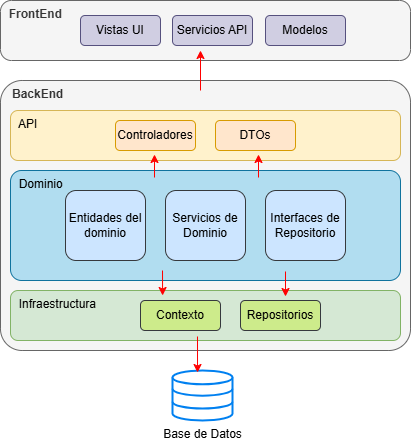
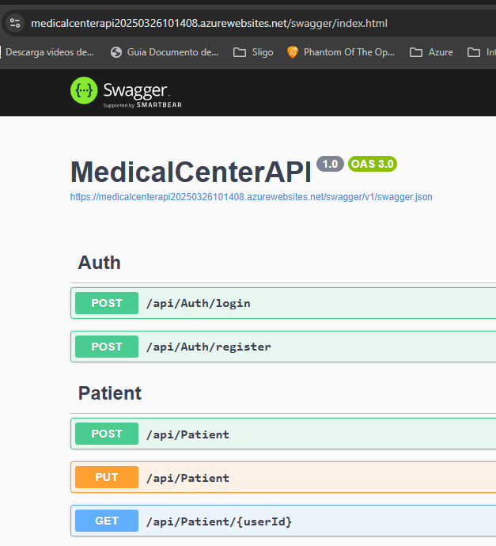
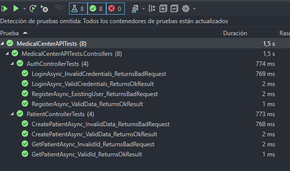

# Medical Center — Backend

Medical Center is an application for managing medical appointments. It is built with React.js on the frontend and .NET 8 on the backend.

The backend exposes services (endpoints) for authentication, creating and editing doctor or patient users, and the business logic required to persist that information in a database.

### Setup

1. Go to the backend folder:

```bash
cd MedicalCenterAPI
```

2. Restore the project dependencies:

```
dotnet restore
```

3. Configure the database connection string in `appsettings.json`:

```
{
  "ConnectionStrings": {
    "DefaultConnection": "Server=YOUR_SERVER;Database=MedicalCenterDB;Trusted_Connection=True;MultipleActiveResultSets=true"
  }
}
```

Replace `YOUR_SERVER` with your SQL server name and `MedicalCenterDB` with your database name.

4. Apply migrations to create the database:

```
dotnet ef database update
```

5. Run the API:

```
dotnet run
```

The API will be available at `https://localhost:7051` or `http://localhost:44313`.

### Deployment

To deploy the backend to a server, publish the project with the following command:

```
dotnet publish -c Release -o ./publish
```

Then copy the published files to the server and configure the production environment.

### Architecture

The .NET 8 / C# backend is an N-layer, domain-driven (DDD) application. Business logic lives in the domain layer and is independent of persistence and controllers.

This project has three layers: domain, infrastructure, and presentation (API).



#### Domain layer

Contains the business entities (user, patient, doctor, city, marital status, disability, document type, and so on), the services with the logic for those objects (registration, login, CRUD operations, appointment scheduling, and so on), and the repository-pattern interfaces.


#### Infrastructure layer

In this project, the infrastructure layer has two responsibilities: database connection logic and implementations of the repository-pattern interfaces.

The repository pattern separates the data layer from business logic: it hides database operations from the other layers so the rest of the application does not depend on the persistence technology in use. This pattern is a good fit when the application may switch database engines or another form of persistence.


#### Presentation layer — API

The presentation layer contains project configuration, dependency injection to bind interfaces to their implementations, and, mainly, the REST API controllers that connect the backend to the frontend through HTTP POST, PUT, GET, and DELETE.

This layer also provides OpenAPI documentation through the Swagger UI, which lists controllers with their endpoints, methods, input parameters, and response objects.



### Unit tests

Each backend project has its own test project.
xUnit and Moq are used to make tests easier to write.


