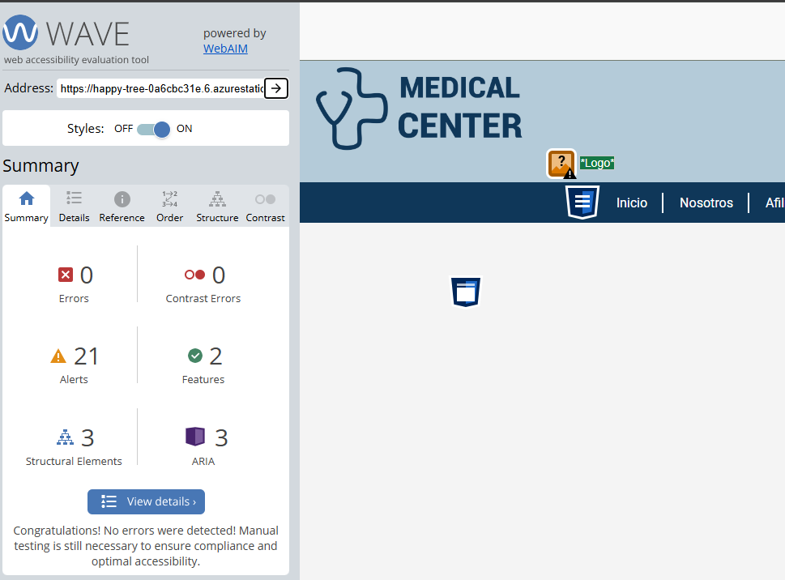
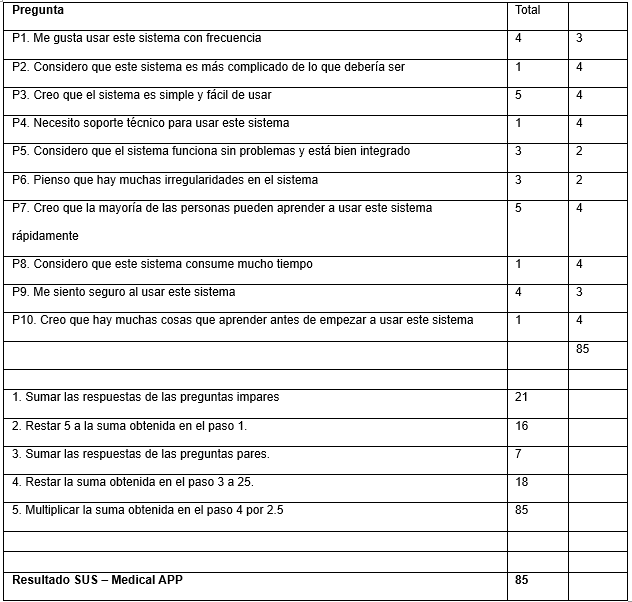
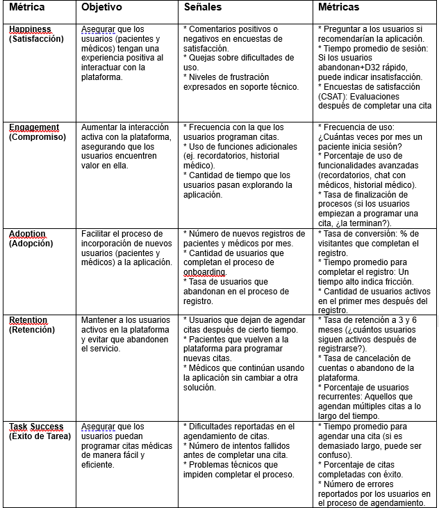
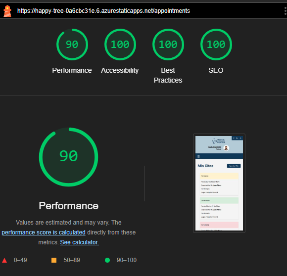
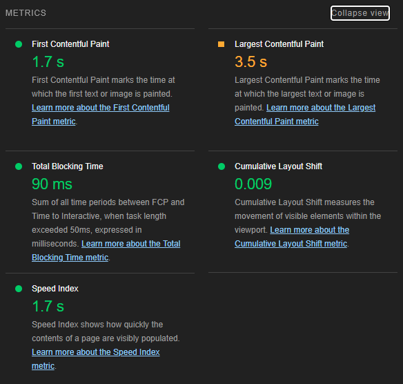
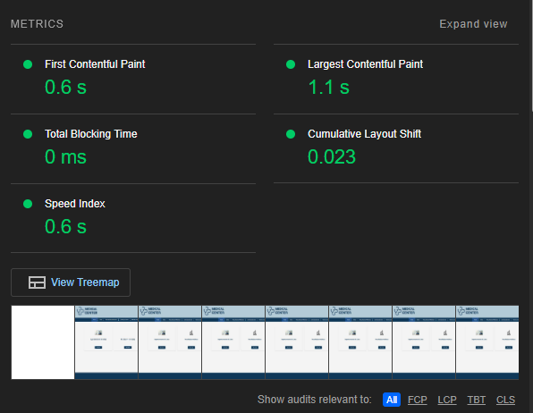
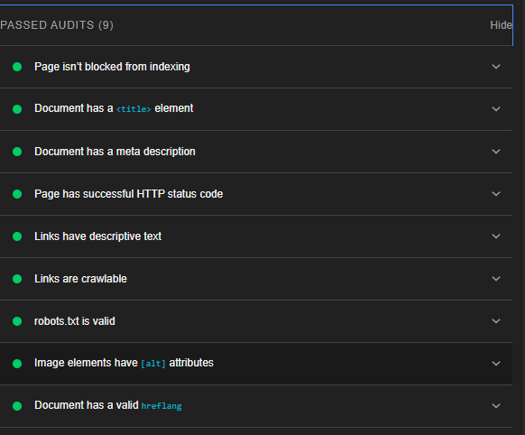

# Usability testing

Usability tests are run to identify specific issues in the application and how users behave during each process.

## WAVE

The page is validated with WAVE. Result: https://wave.webaim.org/report#/https://happy-tree-0a6cbc31e.6.azurestaticapps.net/home

## SUS usability survey

The SUS (System Usability Scale) survey can be used to evaluate usability quickly (Busquets, *Measuring usability with the System Usability Scale (SUS)*, n.d.). On a scale from 1 to 5, where 1 is “Strongly disagree” and 5 is “Strongly agree”, each item suggested by the survey was scored. The result is as follows:

SUS score — Medical APP: **85**

According to the proposed scoring system, this is a high score (71–100): system usability is acceptable, though several improvements can still be made to reach excellence—especially ensuring that the modules work correctly and avoiding error reports that could have been anticipated.

## HEART model

Google’s HEART model can provide relevant information for improving the user experience (Busquets, *Use Google’s HEART method to measure UI/UX*, n.d.).

## Lighthouse

The goal of Lighthouse is to provide relevant, practical guidance for all web developers. Two features are available so you can adapt Lighthouse to your specific needs.

More detail on the tests:
[Lighthouse results](./happy-tree-0a6cbc31e.6.azurestaticapps.net_2025-03-27_21-59-00.report.html)

## Areas for improvement

Based on the HEART model evaluation, the following opportunities for improvement are suggested:

* Optimize navigation with a more intuitive and accessible interface.
* Reduce cognitive load with simpler user flows and visual guidance.
* Add interactive assistance (chatbots, FAQs, live support).
* Increase accessibility options for users with visual and motor disabilities.
* Improve adoption with simplified onboarding and interactive tutorials.
